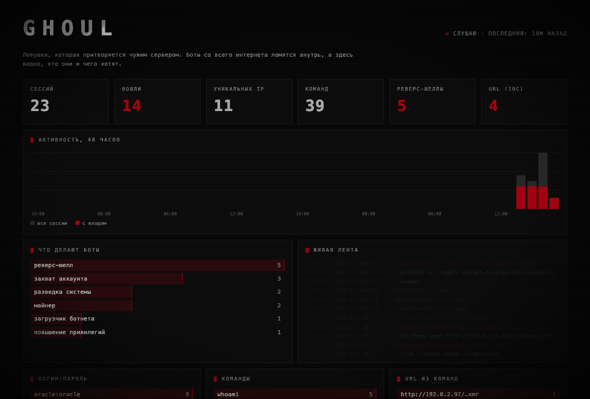

<div align="center">



**Ловушка, которая притворяется взломанным сервером.**
Боты со всего интернета ломятся внутрь, а здесь видно, кто они и чего хотят.

  

</div>

## Зачем это

Любой сервер с открытым SSH через несколько минут начинают долбить автоматические сканеры: перебирают пароли, пробуют зайти, запускают команды. `ghoul` изображает такой сервер, пускает их внутрь и записывает всё, что они делают, а настоящая система при этом не затрагивается.

- перебираемые пары логин:пароль
- команды, которые боты запускают внутри
- адреса, откуда они пытаются скачать вредоносы
- тип атаки простыми словами: загрузчик ботнета, майнер, разведка, захват аккаунта
- **попытки реверс-шелла** (bash `/dev/tcp`, netcat, socat, python, php, powershell) с адресом, куда бот хотел подключиться
- **приёмы повышения привилегий** в духе GTFOBins: `sudo -l`, поиск SUID, `find -exec`, linpeas

<div align="center">

<sub>дашборд на синтетических данных (команда <code>seed-demo</code>), IP из документационных диапазонов. Анимация собрана из кадров демо-базы. Статичный кадр: <a href="assets/dashboard.png">dashboard.png</a>, полная страница: <a href="assets/dashboard-full.png">dashboard-full.png</a></sub>
</div>

## Быстрый старт

```bash
python3 -m venv .venv && .venv/bin/pip install .
.venv/bin/ghoul seed-demo                  # синтетические данные для демо
.venv/bin/ghoul dashboard                  # дашборд на http://127.0.0.1:8080
.venv/bin/ghoul run --port 2222            # приманка, по умолчанию только 127.0.0.1
.venv/bin/ghoul report                     # текстовая сводка по собранному
```

Список сессий в API листается и фильтруется: `/api/sessions?limit=50&offset=100&ip=203.0.113.&attack=майнер`. Лимит ограничен 200, значения подставляются в SQL только параметрами.

Выгрузка событий для анализа вне дашборда (JSON или CSV, с фильтрами по времени и типу события):

```bash
.venv/bin/ghoul export --format json --since 7d                    # всё за неделю, в стандартный вывод
.venv/bin/ghoul export --format csv --kind auth,command --out e.csv   # только пароли и команды в файл
```

Данные в базе пишут атакующие, поэтому в CSV ячейки, начинающиеся с `=`, `+`, `-` или `@`, получают в начале апостроф: иначе таблица выполнила бы такую строку как формулу.

Без установки то же самое делает `python3 -m ghoul …`. Для разработки: `pip install -e ".[dev]"`, затем `pytest`, `ruff check .`, `mypy ghoul`.

Лимиты, которые защищают саму ловушку от заливания (все настраиваются флагами `run`):

| флаг | по умолчанию | что ограничивает |
| :-- | :-- | :-- |
| `--max-connections` | 100 | одновременных соединений всего |
| `--max-per-ip` | 5 | одновременных соединений с одного адреса |
| `--max-sessions` | 50000 | сколько сессий хранить в базе, старые удаляются вместе с событиями |
| `--max-age-days` | 30 | сколько дней хранить сессии |

Внутри: строка ввода обрезается до 4096 символов, длинные поля событий до 2000, на одну сессию записывается не больше 2000 событий, сессия живёт не дольше 10 минут, а простаивающая закрывается через 2 минуты.

## Как устроено

| часть | что делает |
| :-- | :-- |
| SSH-сервер | на asyncssh, выглядит как OpenSSH на Debian 12, первые пароли отклоняет, потом пускает |
| поддельная оболочка | `ls`, `cat`, `wget`, `curl`, цепочки команд и редиректы. Только возвращает правдоподобный текст |
| детектор | `patterns.py`: разбор текста команд на реверс-шеллы и privesc, без исполнения |
| хранилище | SQLite: сессии и события |
| дашборд | веб-страница без внешних зависимостей, живая лента, график, разбор каждой сессии |

## Безопасность

Ничего не исполняется и в сеть оболочка не ходит: `wget` и `curl` только имитируются, URL записываются как индикаторы компрометации. Дашборд слушает только localhost и выводит данные атакующих как текст, без `innerHTML`.

**Где запускать.** Ловушка предназначена для приёма чужого трафика, поэтому держи её на отдельном хосте, виртуальной машине или в контейнере, а не на рабочей машине. Не клади на тот же хост свои ключи и данные, не пробрасывай реальный порт 22 на ловушку и не выставляй дашборд в интернет: он без авторизации.

## Как проверялось

- 29 тестов: поддельная оболочка и файловая система, разбор реверс-шеллов и privesc, классификация атак, хранилище, API дашборда, сквозной SSH-сеанс через настоящий клиент asyncssh.
- Устойчивость: сырые сокеты шлют пустое соединение, HTTP вместо SSH, оборванный баннер, 200 КБ мусора и «баннер» из нулей, после чего обычный вход должен работать, а счётчики соединений вернуться в ноль. Лимиты на всё и на один адрес, вход в 60 КБ без перевода строки, переполнение числа событий, чистка базы по возрасту и количеству.
- В CI на каждый коммит: `ruff`, `mypy` и тесты на Python 3.10, 3.12 и 3.14.

## Ограничения

- Только пароль: вход по ключу отключён, поэтому видно перебор, но не атаки с ключами.
- Поддельная оболочка знает ограниченный набор команд, внимательный человек отличит её от настоящей.
- Один процесс и SQLite: рассчитано на небольшую ловушку, а не на сотни тысяч сессий в сутки.
- Дашборд без авторизации и только на localhost. Выставлять его наружу нельзя.

## Лицензия

MIT, см. [LICENSE](LICENSE).
